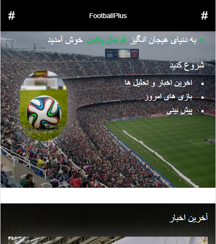
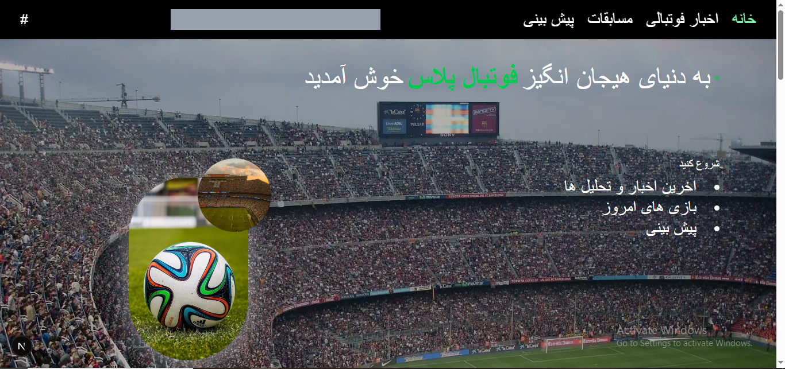
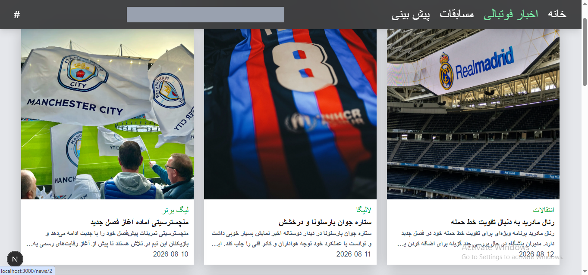
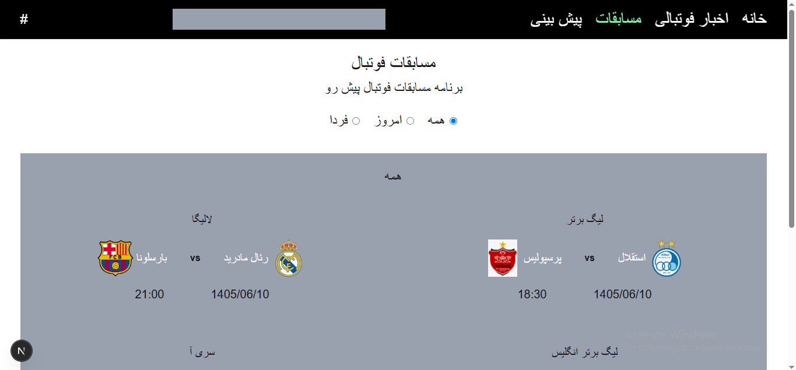
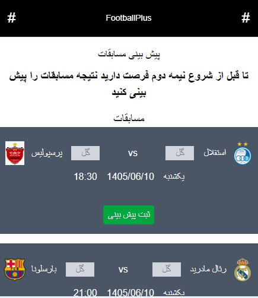
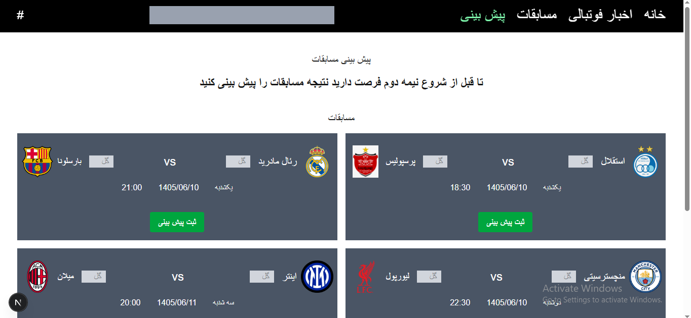

# Football Plus

🔗 Live Demo: https://football-plus2.netlify.app

Football Plus is a responsive football website built with Next.js and TypeScript, following a mobile-first design approach.

The project provides football news, match listings, and match prediction features through a clean and user-friendly interface. The layout is designed for mobile devices first and then adapted to larger screens.

## Features

- Mobile-first responsive design
- Football news listing
- Individual news detail pages
- Football match listings
- Match filtering by day
- Match prediction interface
- Local data management using Mock API
- Client-side prediction storage using Local Storage

## Tech Stack

- React
- Next.js
- TypeScript
- Tailwind CSS
- JSON Server (used during development)
- Mock API (used in the deployed version)
- Data Management
- During development, JSON Server was used as a backend API to manage football news, matches, and predictions.
- For deployment on Netlify, the project was adapted to use an internal Mock API with local JSON data instead of relying on a separate JSON Server instance.
- Predictions are stored in the browser's Local Storage. This means prediction data is saved locally and is not shared between different users or devices.

## Screenshots

The screenshots below showcase the website on mobile and desktop screens.

### Home Page

Mobile

Desktop

### News Page

Desktop

### Matches Page

Desktop

### Predictions Page

Mobile

Desktop

## Prerequisites

- Node.js
- npm

## Installation & Setup

### 1. Clone the Repository

git clone https://github.com/mojtaba-m2/football-plus.git

Navigate to the project directory:

cd football-plus

### 2. Install Dependencies

npm install

### 3. Run the Development Server

npm run dev

Open http://localhost:3000 in your browser to view the website.

Build

To create an optimized production build:

npm run build

Deployment

The project is deployed on Netlify.

You can visit the live demo using the link at the top of this README.

Project Status

Completed as a portfolio project. Further improvements and features may be added in the future.
