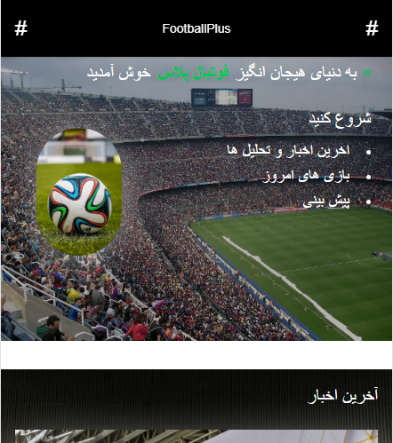
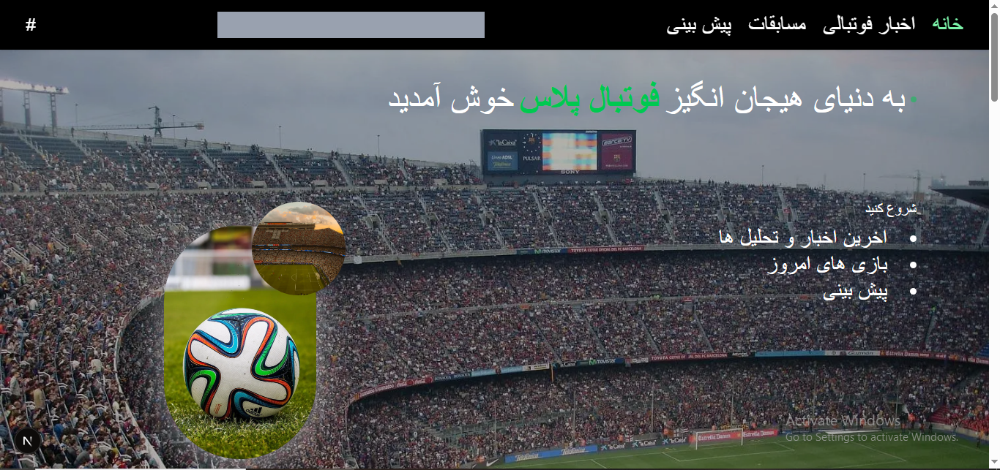
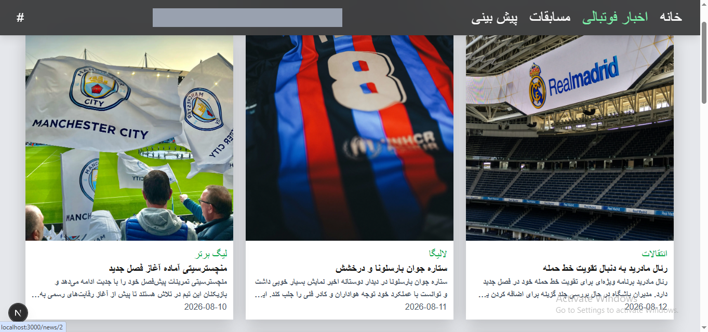
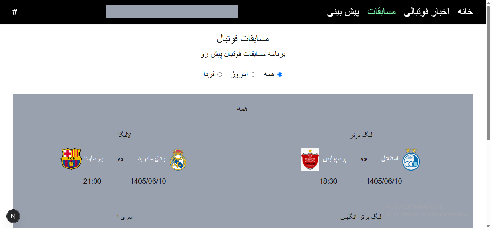
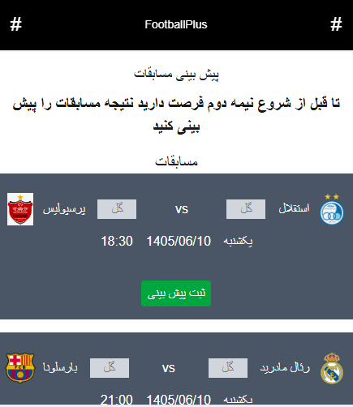
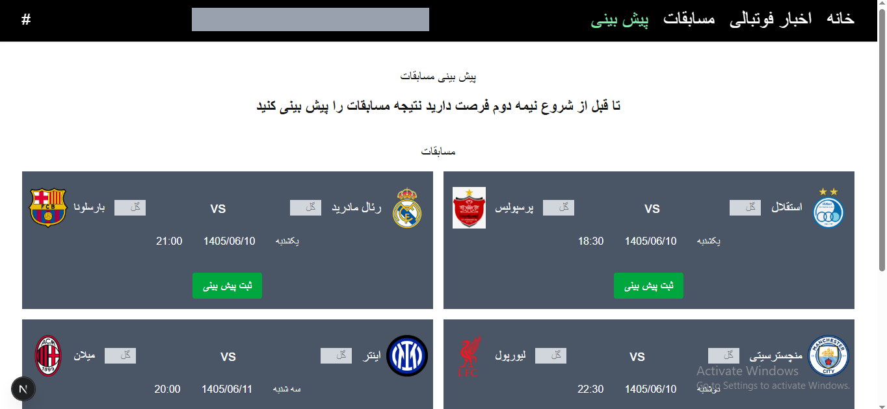

# Football Plus

Football Plus is a responsive football website built with Next.js and TypeScript, following a mobile-first design approach.

The project provides football news, match listings, and match prediction features through a clean and user-friendly interface. The layout is designed for mobile devices first and then adapted to larger screens.

## Features

- Mobile-first responsive design
- Football news listing
- Individual news detail pages
- Football match listings
- Match filtering by day
- Match prediction interface
- Data fetching from a JSON Server API

## Tech Stack

- Next.js
- React
- TypeScript
- Tailwind CSS
- JSON Server

## Screenshots

The screenshots below showcase the website on mobile and desktop screens.

### Home Page

Mobile

Desktop

### News Page

Desktop

### Matches Page

Desktop

### Predictions Page

Mobile

Desktop

## Prerequisites

- Node.js
- npm

## Installation & Setup

### 1. Clone the Repository

Clone the project from GitHub:

bash
git clone <repository-url>

Navigate to the project directory:

bash
cd football-plus

### 2. Install Dependencies

bash
npm install

### 3. Start the JSON Server

Run the JSON Server in a separate terminal:

bash
npm run server

### 4. Start the Development Server

Open another terminal and run:

bash
npm run dev

Open [http://localhost:3000](http://localhost:3000) in your browser to view the website.

## Project Status

This project is under development.